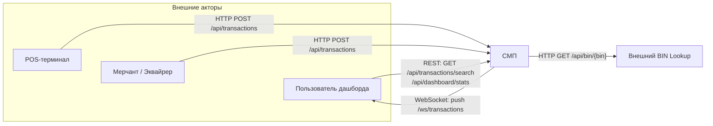

# A1 — C4 Level 1 (Context): границы СМП и внешние акторы

## Пояснение

**Чего не хватало в проекте:** отдельной Context-диаграммы нет — граница «СМП vs внешний мир» не проведена, протоколы входа не зафиксированы.

**Источник:**
- POS-терминал отправляет запросы авторизации в СМП через `POST /api/transactions` — [GatewayClient.java](services/terminal-simulator/src/main/java/com/processing/terminalsimulator/client/GatewayClient.java). То же делает Мерчант/Эквайрер — [GatewayClient.java](services/merchant-acquirer/src/main/java/com/processing/merchantacquirer/client/GatewayClient.java).
- Дашборд обращается к СМП по REST для чтения данных — [client.ts](services/dashboard/src/api/client.ts).
- Дашборд дополнительно подписывается на live-поток транзакций через WebSocket `/ws/transactions` — [useWebSocket.ts](services/dashboard/src/hooks/useWebSocket.ts), а сам эндпоинт WebSocket объявлен в [WebSocketConfig.java](services/transaction-logger/src/main/java/com/processing/transactionlogger/websocket/WebSocketConfig.java).
- СМП обращается к внешнему BIN Lookup за данными об эмитенте по `GET /api/bin/{bin}` — [BinLookupController.java](services/bin-lookup/src/main/java/com/processing/binlookup/controller/BinLookupController.java).