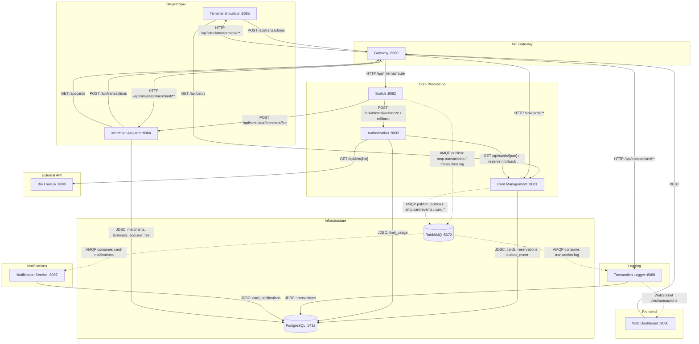

# A2 — C4 Level 2 (Container): сервисы СМП, разметка sync / async

## Пояснение

**Чего не хватало в проекте:** файл `architecture-diagram.puml` есть, но он не различает sync/async — все стрелки одинаковые. Не отражены async-пути: Switch → RabbitMQ → Logger (publisher confirms) и Card-Management outbox → RabbitMQ → Notification. Схема не сверена с `docker-compose.yaml`.

**Разметка связи (суть диаграммы):**
- **Сплошная** = sync (HTTP/JDBC) — проверяется API-тестом (запрос → ответ);
- **Пунктир** = async (AMQP) — проверяется интеграционным тестом (сообщение ушло → подписчик получил → БД изменилась).

**Сверка с docker-compose.yaml:** основных сервисов в compose — 10 (без профиля `observability`), а не 11, как заявлено в задании; observability (prometheus/grafana/loki/promtail/autoscaler) вынесена в отдельный профиль. Это расхождение зафиксировано.

**Для чего пригодится:** для API-тестов (модуль 5) и интеграционных (модуль 6) — видно, какие связи синхронные (тестируем контракт), а какие асинхронные (тестируем очередь и eventual consistency).

**Источник:**
- Gateway проксирует запросы во внутренние сервисы: `/api/internal/route` → Switch, `/api/cards/**` → Card Management, `/api/transactions/**` → Logger, `/api/simulator/**` → Terminal/Merchant — маршруты заданы в [OpenApiGatewayFilterFactory.java](services/gateway/src/main/java/com/processing/gateway/openapi/OpenApiGatewayFilterFactory.java)
- Switch отправляет авторизацию в Authorization (`POST /api/internal/authorize`) — [AuthorizationClient.java](services/switch/src/main/java/com/processing/service/AuthorizationClient.java); откат резервирования (rollback) — там же
- Switch запрашивает комиссию эквайринга у Merchant (`POST /api/simulator/merchant/fee`) — [MerchantAcquirerClient.java](services/switch/src/main/java/com/processing/service/MerchantAcquirerClient.java)
- Authorization обращается в Card Management за картой и резервированием (`GET /api/cards/{pan}`, reserve, rollback) — [CardManagementClientImpl.java](services/authorization/src/main/java/com/processing/authorization/client/CardManagementClientImpl.java)
- Authorization запрашивает данные эмитента у Bin Lookup (`GET /api/bin/{bin}`) — [BinLookupClient.java](services/authorization/src/main/java/com/processing/authorization/client/BinLookupClient.java)
- Terminal и Merchant читают список карт у Card Management (`GET /api/cards`) — [GatewayClient.java](services/terminal-simulator/src/main/java/com/processing/terminalsimulator/client/GatewayClient.java); у Merchant — [GatewayClient.java](services/merchant-acquirer/src/main/java/com/processing/merchantacquirer/client/GatewayClient.java)
- Card Management пишет в PostgreSQL через JDBC-репозитории — [CardRepositoryPersistenceAdapter.java](services/card-management/src/main/java/com/processing/cardmanagement/repositories/CardRepositoryPersistenceAdapter.java), [ReservationRepositoryPersistenceAdapter.java](services/card-management/src/main/java/com/processing/cardmanagement/repositories/ReservationRepositoryPersistenceAdapter.java), [OutboxJpaAdapter.java](services/card-management/src/main/java/com/processing/cardmanagement/repositories/OutboxJpaAdapter.java), [ReservationRollbackRepositoryPersistenceAdapter.java](services/card-management/src/main/java/com/processing/cardmanagement/repositories/ReservationRollbackRepositoryPersistenceAdapter.java)
- Merchant пишет в PostgreSQL (таблицы merchants/terminals/acquirer_fee) — переменные `POSTGRES_*` в `docker-compose.yaml`
- Switch отправляет транзакцию в Logger через RabbitMQ — [LoggerClient.java](services/switch/src/main/java/com/processing/service/LoggerClient.java) вызывает `rabbitTemplate.convertAndSend(EXCHANGE, ROUTING_KEY, transaction)` в exchange `smp.transactions` (routing key `transaction.log`) → очередь `transaction-log`; если брокер не принял сообщение, Switch вызывает `rollback` у Authorization (отмена резервирования средств)
- Card Management публикует события о картах через outbox в RabbitMQ — [OutboxEventProcessorImpl.java](services/card-management/src/main/java/com/processing/cardmanagement/services/OutboxEventProcessorImpl.java) вызывает `rabbitTemplate.convertAndSend(EXCHANGE, ROUTING_KEY, event)` в exchange `smp.card-events` (routing key `card.*`) → очередь `card-notifications`; обработчик запускается периодически ([OutboxProcessor.java](services/card-management/src/main/java/com/processing/cardmanagement/services/OutboxProcessor.java), `@Scheduled`) и читает из БД события в статусе PENDING
