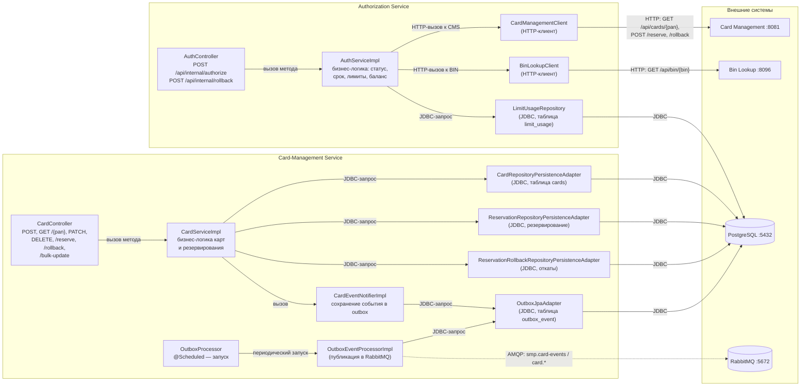

# A3 — C4 Level 3 (Component): Authorization и Card-Management

## Пояснение

**Чего не хватало в проекте:** компонентного уровня нет вообще — в документации нет схемы «что внутри сервиса». Построено с нуля по пакетам кода.

**Структура (controller → service → client/repository):**
- **Authorization**: `AuthController` → `AuthServiceImpl` → HTTP-клиенты (`CardManagementClient` к CMS, `BinLookupClient` к BIN) + `LimitUsageRepository` (JDBC).
- **Card-Management**: `CardController` → `CardServiceImpl` → репозитории (JDBC) + outbox-публикация (`OutboxEventProcessorImpl` → RabbitMQ).

**Где что можно тестировать (для unit, модуль 4):**
- **Чистая логика** — сервисы (`AuthServiceImpl.authorize`, `CardServiceImpl`): юнит-тест без зависимостей.
- **Stub/mock** — HTTP-клиенты (`CardManagementClient`, `BinLookupClient`): подменяются двойниками, реальный HTTP не нужен.
- **Реальная зависимость** — репозитории (JDBC) и outbox/очередь: здесь интеграционный тест с БД/брокером.

**Для чего пригодится:** для выбора тестовых двойников — где stub/mock (HTTP-клиенты), а где настоящая зависимость (репозиторий, очередь).

## Что в коде находится (по компонентам)

**Authorization:**
- REST-контроллер принимает запросы на авторизацию и откат и делегирует обработку в сервис — `controller/AuthController.java` (эндпоинты `authorize` и `rollback`, путь `/api/internal`).
- `AuthServiceImpl` — вся бизнес-логика принятия решения: проверяет статус карты, срок действия, дневной/месячный лимит, доступный баланс; при одобрении резервирует средства и генерирует RRN/authCode — `services/AuthServiceImpl.java`.
- HTTP-клиент к Card Management: `getCard`, `reserve`, `rollback` (методы на стр. 36, 40, 70, 74, 105, 109) — `client/CardManagementClientImpl.java`.
- HTTP-клиент к Bin Lookup: запрос данных эмитента по BIN (стр. 59) — `client/BinLookupClient.java`.
- Доступ к таблице `limit_usage` (учёт дневных/месячных лимитов) — `repositories/LimitUsageRepository.java`.

**Card-Management:**
- REST-контроллер CRUD карт и операций резервирования/отката: создание, получение, обновление, удаление, `/reserve` (стр. 218), `/rollback`, `/bulk-update` — `controllers/CardController.java`.
- Бизнес-логика карт и резервирования: `createCard`, `getCard`, `reserve`, `patch`, `rollback` — `services/CardServiceImpl.java`.
- Сохранение карточного события (создание/обновление/резервирование/откат) в таблицу `outbox_event` — `events/CardEventNotifierImpl.java`.
- Периодический запуск обработки outbox (по расписанию, `@Scheduled`) — `services/OutboxProcessor.java`.
- Чтение событий из `outbox_event`, публикация их в RabbitMQ и смена статуса (PENDING → PROCESSED) — `services/OutboxEventProcessorImpl.java`.

**Репозитории Card-Management (JDBC, таблицы PostgreSQL):**
- `repositories/CardRepositoryPersistenceAdapter.java` — таблица `cards`;
- `repositories/ReservationRepositoryPersistenceAdapter.java` — резервирование;
- `repositories/ReservationRollbackRepositoryPersistenceAdapter.java` — откаты;
- `repositories/OutboxJpaAdapter.java` — таблица `outbox_event`.