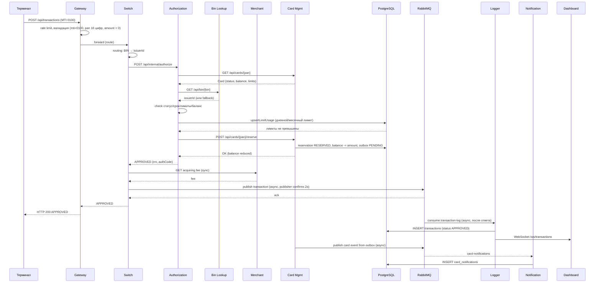
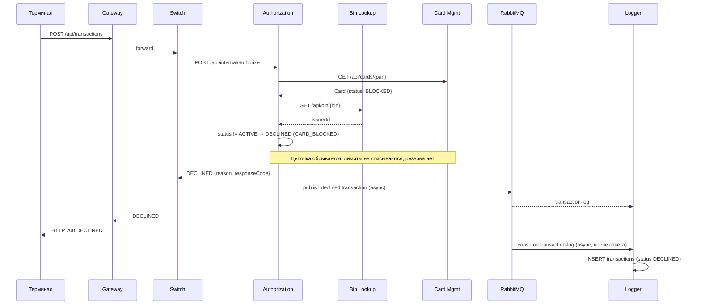
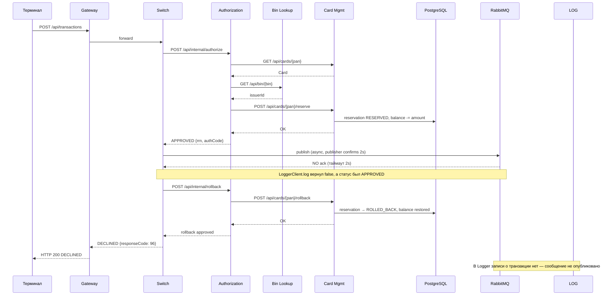

# A4 — Sequence: путь транзакции (happy path / declined / reversal)

## Сценарий 1 — Happy path (всё одобрено)

**Ключевое:** всё одобрено. Sync (HTTP) — цепочка до ответа клиенту: Терминал → Gateway → Switch → Authorization → (Bin Lookup, Card Management) → резервирование, плюс комиссия у Merchant; лимиты пишутся в БД (`limit_usage`). Async (AMQP) — публикация в RabbitMQ → Logger (и outbox → Notification), записи появляются **после** ответа клиенту (eventual consistency); Logger дополнительно рассылает транзакцию дашборду по WebSocket.

---

## Сценарий 2 — Declined (карта BLOCKED)

**Ключевое:** синхронная цепочка обрывается на Authorization — карта `BLOCKED` → `DECLINED` (`CARD_BLOCKED`), **не доходя** до лимитов/баланса и резервирования. Резервирование не выполнялось → rollback не нужен. Switch всё равно публикует declined-транзакцию в Logger. Клиент получает `HTTP 200` со статусом `DECLINED`.

---

## Сценарий 3 — Reversal (publisher-confirm не получен → откат)

**Ключевое:** транзакция одобрена и средства зарезервированы, но Switch не получил publisher-confirm за 2s → откатывает резервирование (`rollback`), клиент получает `DECLINED` с `responseCode: 96`. Гарантия: **ни одна транзакция не станет APPROVED без записи в очереди**; в Logger записи нет (сообщение не опубликовано).

---

## Пояснение

**Чего не хватало в проекте:** mermaid-sequence в `architecture.md` покрывает только happy path. Нет declined и reversal, хотя в коде есть и `DeclineOutcome` (все ветки отказа), и publisher confirms с откатом. Эти два сценария — самые ценные для тестирования.

**Где sync, где async (ключ к eventual consistency):**
- **Sync (HTTP)** — вся цепочка до ответа клиенту: Gateway → Switch → Authorization → (Bin Lookup, Card Management) → резервирование.
- **Async (AMQP)** — публикация в RabbitMQ → Logger. Запись в Logger появляется **не в момент ответа клиенту, а позже** (eventual consistency). E2E-тест должен ждать условие, а не спать фиксированное время.

**Для чего пригодится:** для E2E (модуль 7) и интеграционных (модуль 6) — видно, какие проверки можно сделать на нижних уровнях, а что требует полного контура (например, eventual-consistency запись в Logger нельзя проверить unit/API-тестом).

## Подтверждение кодом

Каждый шаг диаграммы подтверждается конкретным файлом и вызовом. Пути — от корня репозитория (ссылки ведут на файл).

### Шаги, общие для всех сценариев

- **Terminal и Merchant отправляют транзакцию в Gateway.** Оба эмулятора делают HTTP-запрос `POST` на `/api/transactions` — [GatewayClient.java](services/terminal-simulator/src/main/java/com/processing/terminalsimulator/client/GatewayClient.java) (метод `sendToGateway`); у Merchant аналогично в [GatewayClient.java](services/merchant-acquirer/src/main/java/com/processing/merchantacquirer/client/GatewayClient.java).
- **Gateway сначала применяет rate limit, потом валидацию.** Очередность задана через `getOrder`: [TransactionRateLimitFilter.java](services/gateway/src/main/java/com/processing/gateway/ratelimit/TransactionRateLimitFilter.java) (`HIGHEST_PRECEDENCE + 1`) и [TransactionValidationFilter.java](services/gateway/src/main/java/com/processing/gateway/validation/TransactionValidationFilter.java) (`HIGHEST_PRECEDENCE + 2`), валидатор вызывается методом `validator.validate(authorizationRequest)`.
- **Switch определяет issuerId по BIN и вызывает Authorization.** [RouteService.java](services/switch/src/main/java/com/processing/service/RouteService.java) вызывает `routingService.getIssuerIdByPan(pan)`, затем `authorizationClient.authorize(routedRequest)`; сам HTTP-запрос `POST /api/internal/authorize` выполняет [AuthorizationClient.java](services/switch/src/main/java/com/processing/service/AuthorizationClient.java) (метод `callAuthorize`).
- **Authorization получает карту из Card-Management.** [AuthServiceImpl.java](services/authorization/src/main/java/com/processing/authorization/services/AuthServiceImpl.java) вызывает `cardManagementClient.getCard(request.pan())` (HTTP `GET /api/cards/{pan}`); клиент — [CardManagementClientImpl.java](services/authorization/src/main/java/com/processing/authorization/client/CardManagementClientImpl.java).
- **Switch запрашивает комиссию у Merchant-Acquirer.** Сразу после `authorize`, при любом статусе, [RouteService.java](services/switch/src/main/java/com/processing/service/RouteService.java) вызывает `acquiringFeeClient.fetchAcquiringFee(...)`; сам запрос `POST /api/simulator/merchant/fee` выполняет [MerchantAcquirerClient.java](services/switch/src/main/java/com/processing/service/MerchantAcquirerClient.java).
- **Switch публикует транзакцию в RabbitMQ.** [RouteService.java](services/switch/src/main/java/com/processing/service/RouteService.java) вызывает `tryLog(transaction)`; публикацию выполняет [LoggerClient.java](services/switch/src/main/java/com/processing/service/LoggerClient.java) через `rabbitTemplate.convertAndSend(EXCHANGE, ROUTING_KEY, transaction)`.
- **Logger получает сообщение, сохраняет запись и рассылает по WebSocket.** [TransactionLogListener.java](services/transaction-logger/src/main/java/com/processing/transactionlogger/listener/TransactionLogListener.java) (метод `handleTransaction`) вызывает `transactionService.store(request)`; сохранение (`saveAndFlush`) и рассылку (`webSocketManager.broadcast`) делает [TransactionService.java](services/transaction-logger/src/main/java/com/processing/transactionlogger/service/TransactionService.java).

### Happy path

- **Authorization обращается к Bin Lookup, но результат использует только для лога.** [AuthServiceImpl.java](services/authorization/src/main/java/com/processing/authorization/services/AuthServiceImpl.java) вызывает `binLookupClient.getIssuerId(pan).ifPresentOrElse(issuerId -> log.info(...), ...)` — значение дальше нигде не используется; клиент — [BinLookupClient.java](services/authorization/src/main/java/com/processing/authorization/client/BinLookupClient.java).
- **Проверки статуса, срока и баланса.** В [AuthServiceImpl.java](services/authorization/src/main/java/com/processing/authorization/services/AuthServiceImpl.java): сравнение статуса `!currCardStatus.equals(CardModelStatus.ACTIVE)`, проверка срока `lastValidDay.isBefore(transmissionDate)`, сравнение суммы с балансом `request.amount().compareTo(cardResponse.availableBalance()) > 0`.
- **Учёт лимитов и генерация RRN.** [AuthServiceImpl.java](services/authorization/src/main/java/com/processing/authorization/services/AuthServiceImpl.java) вызывает `checkAndUpdateLimits` (внутри `limitUsageRepository.upsertLimitUsage`) и `generateRRN` (внутри `limitUsageRepository.fetchRrnBlock`); репозиторий — [LimitUsageRepository.java](services/authorization/src/main/java/com/processing/authorization/repositories/LimitUsageRepository.java).
- **Резервирование выполняется одной транзакцией БД.** [AuthServiceImpl.java](services/authorization/src/main/java/com/processing/authorization/services/AuthServiceImpl.java) вызывает `cardManagementClient.reserve(amount, rrn, pan)`; в [CardServiceImpl.java](services/card-management/src/main/java/com/processing/cardmanagement/services/CardServiceImpl.java) (метод `reserve`) внутри `transactionRunner.runSupplier` идут `reservationRepository.save`, `cardRepository.update(card.withReservation(reservation))` и `eventNotifier.notifyListeners(new CardServiceReserveEvent(...))`.
- **Событие карты уходит через outbox в Notification.** [OutboxProcessor.java](services/card-management/src/main/java/com/processing/cardmanagement/services/OutboxProcessor.java) обрабатывает outbox по расписанию; уведомление сохраняет реализация интерфейса [CardEventListener.java](services/card-management/src/main/java/com/processing/cardmanagement/events/CardEventListener.java) (метод `handleCardEvent`).

### Declined

- **Карта BLOCKED обрывает цепочку до лимитов и резерва.** В [AuthServiceImpl.java](services/authorization/src/main/java/com/processing/authorization/services/AuthServiceImpl.java) ветка `case CardModelStatus.BLOCKED` возвращает `DeclineOutcome.CARD_BLOCKED.buildAuthorization(...)` раньше проверки лимитов и резервирования; в [DeclineOutcome.java](services/authorization/src/main/java/com/processing/authorization/constants/DeclineOutcome.java) этому исходу соответствует код `05`.
- **Authorization отвечает HTTP 403, но Switch берёт решение из тела.** [AuthControllerImpl.java](services/authorization/src/main/java/com/processing/authorization/controller/AuthControllerImpl.java) мапит `REASON_CARD_EXPIRED / REASON_CARD_BLOCKED / REASON_CARD_INACTIVE` на `HttpStatus.FORBIDDEN`; клиент [AuthorizationClient.java](services/switch/src/main/java/com/processing/service/AuthorizationClient.java) не бросает ошибку на 403 (пустой `onStatus`), поэтому Switch разбирает тело ответа.

### Reversal

- **Публикация не удалась.** [LoggerClient.java](services/switch/src/main/java/com/processing/service/LoggerClient.java) перехватывает `AmqpException` и возвращает `false` (`catch (AmqpException e) { ... return false; }`).
- **Откат средств по цепочке Switch → Authorization → Card-Management.** [RouteService.java](services/switch/src/main/java/com/processing/service/RouteService.java) при условии `if (!logged && STATUS_APPROVED.equals(response.status()))` вызывает `authorizationClient.rollback(routedRequest, response.rrn())`; [AuthorizationClient.java](services/switch/src/main/java/com/processing/service/AuthorizationClient.java) выполняет `POST /api/internal/rollback`; [AuthServiceImpl.java](services/authorization/src/main/java/com/processing/authorization/services/AuthServiceImpl.java) в методе `rollback` вызывает `cardManagementClient.rollback(request)`; [CardServiceImpl.java](services/card-management/src/main/java/com/processing/cardmanagement/services/CardServiceImpl.java) в методе `rollback` делает `reservation.rolledBack(rollback)` и `card.withRollback(rollback)`.
- **Клиент получает DECLINED с кодом 96, и в журнале записи нет.** [RouteService.java](services/switch/src/main/java/com/processing/service/RouteService.java) сразу после отката возвращает `AuthorizationResponse.systemError(request.stan())`, повторной публикации нет; [AuthorizationResponse.java](services/common/src/main/java/com/processing/common/dto/authorization/AuthorizationResponse.java) для `systemError` задаёт `"96"` и `"DECLINED"`.

### Чего в коде нет

- **Сообщения `mti=0400` в коде нет.** В [AuthorizationRequest.java](services/common/src/main/java/com/processing/common/dto/authorization/AuthorizationRequest.java) объявлен метод `forReversal`, но поиск по всей папке `services/` находит только само объявление — реального формирования `mti=0400` нет. Плюс валидатор требует строго `"0100"` (`if (!"0100".equals(request.mti()))` в [TransactionRequestValidator.java](services/gateway/src/main/java/com/processing/gateway/validation/TransactionRequestValidator.java)). «Reversal 0400» — это обозначение из документации, а не фактический код.
- **Явного ожидания подтверждения брокера в коде нет.** Поиск `CorrelationData`, `ConfirmCallback`, `waitForConfirms` в `services/switch` ничего не даёт; есть только настройка `publisher-confirm-type: correlated` в `services/switch/src/main/resources/application.yml`. То есть «не получил ack за 2 секунды» в коде не реализовано как ожидание — публикация просто возвращает `false` при исключении.
- **`limit_usage` при откате не уменьшается.** В методе `rollback` у [AuthServiceImpl.java](services/authorization/src/main/java/com/processing/authorization/services/AuthServiceImpl.java) есть только `cardManagementClient.rollback(request)`, обращений к `limitUsageRepository` нет — израсходованный лимит остаётся как был.