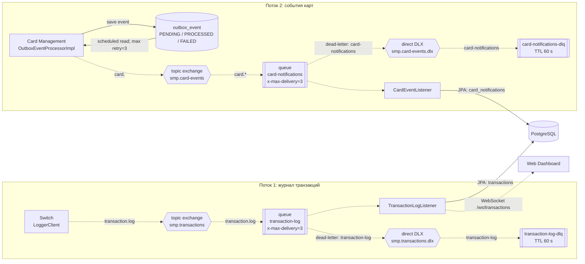

# A5 — RabbitMQ-топология: exchange → queue → consumer, DLX/DLQ

## Пояснение

**Для чего пригодится:** для интеграционных тестов с очередями (модуль 6) — видно, где проверять доставку (потребление из основной очереди → запись в БД), где retry (после сбоя consumer, до 3 доставок), а где DLQ (сообщение, не прошедшее обработку). Также видно outbox: сначала событие в БД (`outbox_event`), затем публикация в очередь.

**Источник:**

**Путь A — Switch → Logger:**

Switch публикует транзакции в `smp.transactions` (key `transaction.log`) → очередь `transaction-log` → `TransactionLogListener` пишет в БД.
- Конфигурация топологии (exchange/queue/DLX/DLQ, `x-max-delivery=3`, TTL 60s) — [RabbitMQConfig.java](services/switch/src/main/java/com/processing/config/RabbitMQConfig.java), зеркально у Logger — [RabbitMQConfig.java](services/transaction-logger/src/main/java/com/processing/transactionlogger/config/RabbitMQConfig.java);
- Producer — [LoggerClient.java](services/switch/src/main/java/com/processing/service/LoggerClient.java), публикует через `rabbitTemplate.convertAndSend(EXCHANGE, ROUTING_KEY, transaction)`;
- Consumer — [TransactionLogListener.java](services/transaction-logger/src/main/java/com/processing/transactionlogger/listener/TransactionLogListener.java), запись в БД — [TransactionService.java](services/transaction-logger/src/main/java/com/processing/transactionlogger/service/TransactionService.java).

**Путь C — Card Mgmt (outbox) → Notification:**

событие сохраняется в `outbox_event` → `OutboxEventProcessorImpl` публикует в `smp.card-events` (key `card.*`) → очередь `card-notifications` → `CardEventListener` пишет в БД.
- Конфигурация топологии — [RabbitMQConfig.java](services/card-management/src/main/java/com/processing/cardmanagement/config/RabbitMQConfig.java);
- Producer (outbox) — [OutboxEventProcessorImpl.java](services/card-management/src/main/java/com/processing/cardmanagement/services/OutboxEventProcessorImpl.java), запуск по расписанию — [OutboxProcessor.java](services/card-management/src/main/java/com/processing/cardmanagement/services/OutboxProcessor.java), статусы `PENDING / PROCESSED / FAILED`;
- Consumer — [CardEventListener.java](services/card-management/src/main/java/com/processing/cardmanagement/events/CardEventListener.java).

**Механика отказа (DLX/DLQ) — одинаковая для обоих путей:** retry — сообщение возвращается в очередь до 3 доставок (`x-max-delivery=3`) при исключении в consumer; DLQ — после исчерпания попыток сообщение через dead-letter exchange (DLX) попадает в DLQ (`transaction-log-dlq` / `card-notifications-dlq`); TTL — сообщения в DLQ живут 60 секунд.

**Общее:** настройка publisher confirms — `publisher-confirm-type: correlated` в [application.yml](services/switch/src/main/resources/application.yml).