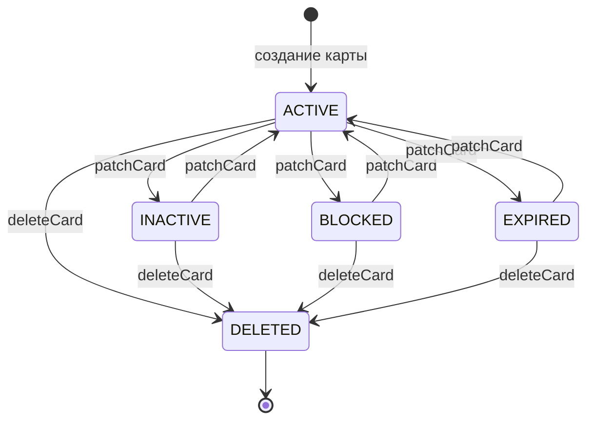
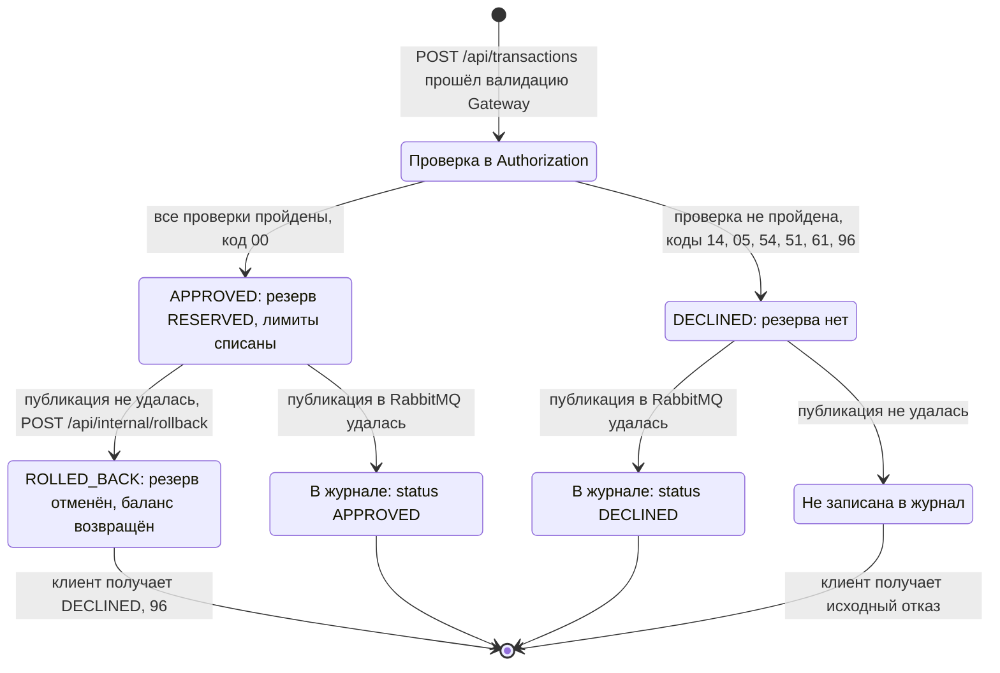

# A6 — State-transition: Card.status и жизненный цикл Transaction

## Чего не хватало и что сделано

- Диаграмм состояний в проекте не было. В документации статусы только перечислены, переходы и их причины не описаны.
- Сделано: две диаграммы по коду — статус карты (`CardStatus`) и жизненный цикл транзакции/резервирования. У каждого перехода подписано, каким вызовом он выполняется.

## 1. Card.status

## 2. Жизненный цикл транзакции и резервирования

В модели `TransactionStatus` есть только `APPROVED` и `DECLINED`; запись в журнале после сохранения не меняется. `ROLLED_BACK` — фактическое состояние `ReservationStatus`, показано как логическое завершение операции после отмены ранее одобренного резервирования, а не как значение `transactions.status`.

## Источник

**Статусы карты (Card.status):**
- Набор статусов — [CardStatus.java](services/card-management/src/main/java/com/processing/cardmanagement/models/CardStatus.java): `ACTIVE`, `INACTIVE`, `BLOCKED`, `EXPIRED`, `DELETED`.
- Новая карта создаётся со статусом `ACTIVE` — [CardServiceImpl.java](services/card-management/src/main/java/com/processing/cardmanagement/services/CardServiceImpl.java), метод `createCard`.
- Смена статуса (`patchCard` / `bulkUpdateStatus`) — [CardServiceImpl.java](services/card-management/src/main/java/com/processing/cardmanagement/services/CardServiceImpl.java); сам переход делает [Card.java](services/card-management/src/main/java/com/processing/cardmanagement/models/Card.java) — `withData` проверяет только лимиты, направление перехода не ограничивает.
- Допустимые статусы в PATCH (без `DELETED`) — [PatchCardRequest.java](services/common/src/main/java/com/processing/common/dto/cardmanagement/PatchCardRequest.java) и [CardModelStatus.java](services/common/src/main/java/com/processing/common/dto/cardmanagement/CardModelStatus.java).
- Удаление (soft delete) и скрытие удалённых — `Card.deleted()`; [CardEntity.java](services/card-management/src/main/java/com/processing/cardmanagement/models/CardEntity.java) — `@SQLRestriction("status <> 'DELETED'")`.
- Резервирование разрешено только для `ACTIVE` — `Card.checkStatusOrThrow` → `IllegalStateException` → 409 в [GlobalExceptionHandler.java](services/card-management/src/main/java/com/processing/cardmanagement/configuration/GlobalExceptionHandler.java).
- Отказ по статусу карты — [AuthServiceImpl.java](services/authorization/src/main/java/com/processing/authorization/services/AuthServiceImpl.java) и [DeclineOutcome.java](services/authorization/src/main/java/com/processing/authorization/constants/DeclineOutcome.java).

**Жизненный цикл транзакции и резервирования:**
- Статусы транзакции — [TransactionStatus.java](services/common/src/main/java/com/processing/common/dto/transactionlogger/TransactionStatus.java): только `APPROVED` и `DECLINED`.
- Статусы резерва — [ReservationStatus.java](services/card-management/src/main/java/com/processing/cardmanagement/models/ReservationStatus.java): `RESERVED`, `ROLLED_BACK`; переход в [Reservation.java](services/card-management/src/main/java/com/processing/cardmanagement/models/Reservation.java) — `rolledBack`.
- Повторный откат — `Reservation.startRollback` → `RollbackAlreadySatisfiedException` → 409 → `ALREADY_ROLLED_BACK`.
- Ветка отката в Switch (при неудачной публикации) — [RouteService.java](services/switch/src/main/java/com/processing/service/RouteService.java), метод `route`.

## Что увидел в коде и чего нет в документации

- **Автоматического перехода `ACTIVE` → `EXPIRED` нет.** Планировщика, который менял бы статус по `expiryDate`, в коде нет. Authorization сам сравнивает срок с датой транзакции и отклоняет с кодом `54`, а статус карты остаётся `ACTIVE`. На диаграмме `EXPIRED` достижим только через PATCH.
- **У транзакции нет статуса `ROLLED_BACK`.** Это статус резерва в Card-Management. Отменённая транзакция в журнал не попадает, клиенту возвращается `DECLINED` с кодом `96`.
- **Переходы между четырьмя рабочими статусами карты не ограничены**: PATCH переводит из любого статуса в любой.

## Для чего пригодится

Каждый переход — отдельная проверка (E2E, модуль 7; state-transition, модуль 2):
- заблокировали карту → транзакция отклонена → разблокировали → транзакция одобрена;
- удалили карту → карта не находится, транзакция отклонена с кодом `14`;
- одобрили → публикация не удалась → резерв отменён, баланс вернулся;
- повторный откат того же резерва → 409.
